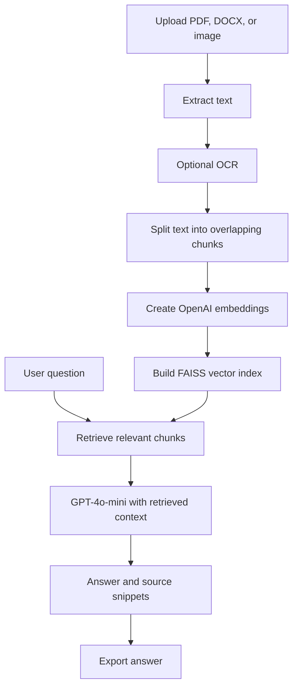

# Document Analyzer Suite

### AI-powered document summarization, OCR, spreadsheet insights, and retrieval-augmented question answering

**Document Analyzer Suite** is a [Streamlit](https://streamlit.io/) application for exploring information in PDFs, Word documents, images, and spreadsheets. It combines traditional text extraction, [Tesseract OCR](https://github.com/tesseract-ocr/tesseract), OpenAI language models, and a [FAISS](https://github.com/facebookresearch/faiss) vector index.

The application provides two workflows:

- **Document Summarizer:** Extract relevant text, produce concise AI summaries, or analyze spreadsheet data.
- **Advanced Analyzer:** Use **Retrieval-Augmented Generation (RAG)** to ask questions grounded in the uploaded document.

> **Implementation note:** The summarizer intentionally focuses on the first page or a detected table of contents rather than summarizing every page. The Advanced Analyzer processes broader document content and is the workflow to use for document-based Q&A.

---

## Table of contents

1. [Features](#features)
2. [Supported file formats](#supported-file-formats)
3. [How RAG works](#how-rag-works)
4. [Technology stack](#technology-stack)
5. [Project structure](#project-structure)
6. [Getting started](#getting-started)
7. [How to use the application](#how-to-use-the-application)
8. [Deployment](#deployment)
9. [Configuration and implementation details](#configuration-and-implementation-details)
10. [Known limitations](#known-limitations)
11. [Security and privacy](#security-and-privacy)
12. [Troubleshooting](#troubleshooting)
13. [Future enhancements](#future-enhancements)
14. [License](#license)

## Features

### 1. Document Summarizer

- Upload **PDF, DOCX, JPG, PNG, or TIFF** files for text extraction and summarization.
- Extract selectable content using **PyPDF2**, **pdfplumber**, **python-docx**, and **Tesseract OCR** when required.
- Inspect extraction status through an **Extraction Process Log**.
- Detect whether the initial extracted text is substantial; otherwise, look for potential index/table-of-contents content.
- Generate a short bullet-point summary with **OpenAI GPT-4o-mini**.
- Preview the extracted text and see character and word counts.
- Download generated summaries as **TXT, DOCX, PDF, or JSON**.

**For spreadsheets (CSV/XLSX), the same mode also supports:**

- Data previews, row/column counts, missing-value counts, and descriptive statistics.
- GPT-4o-mini-powered insights from spreadsheet contents.
- Export of insights as **TXT, DOCX, PDF, or JSON**.
- Export of processed tabular data as **CSV or XLSX**, and basic analysis as **JSON**.

### 2. Advanced Analyzer — RAG-based document Q&A

- Upload **PDF, DOCX, JPG, PNG, or TIFF** files.
- Identify broad document categories such as text-based, scanned, image-only, or mixed-content PDFs.
- Extract text from PDFs and Word document paragraphs.
- Optionally OCR PDF pages; OCR images with Tesseract.
- Split extracted content into overlapping chunks.
- Generate vector embeddings with **OpenAI `text-embedding-3-small`**.
- Build a **FAISS** vector index and retrieve relevant passages for questions.
- Answer questions using **GPT-4o-mini** and a retrieval chain.
- Use quick prompts such as **Data** and **Key Points**, or enter custom questions.
- Inspect snippets from retrieved source documents.
- Download answers as **TXT, DOCX, PDF, or JSON**.

**Example questions**

- "What are the main findings or conclusions?"
- "What numerical data or statistics are mentioned?"
- "What risks are described in the report?"
- "Summarize the recommendations in this document."

Answers depend on what the extraction and retrieval stages can read; the app does not guarantee that every answer is complete or correct.

## Supported file formats

| File format | Document Summarizer | Advanced Analyzer | Notes |
| --- | :---: | :---: | --- |
| PDF (`.pdf`) | Yes | Yes | Text extraction; OCR fallback or optional OCR |
| Word (`.docx`) | Yes | Yes | Summarizer uses a limited text excerpt; Analyzer reads paragraphs |
| JPEG (`.jpg`) | Yes | Yes | OCR-based extraction |
| PNG (`.png`) | Yes | Yes | OCR-based extraction |
| TIFF (`.tiff`) | Yes | Yes | OCR-based extraction |
| CSV (`.csv`) | Yes | No | Spreadsheet preview, statistics, and AI insights |
| Excel (`.xlsx`) | Yes | No | Spreadsheet preview, statistics, and AI insights |

> **Excel-specific behavior:** The current implementation loads XLSX files with `skiprows=1`, skipping the first worksheet row. For workbooks where the first row contains the actual headers, the parsed data may be misaligned. CSV files use normal `pandas.read_csv` behavior.

## How RAG works

Retrieval-Augmented Generation (RAG) helps an AI model answer questions using information retrieved from an uploaded document, rather than relying only on the model's general knowledge.



### The retrieval process in this implementation

1. **Extraction:** Read document text using PyPDF2 or python-docx, and optionally supplement PDF text with Tesseract OCR. Image files are processed through OCR.
2. **Chunking:** `RecursiveCharacterTextSplitter` creates chunks of **800 characters** with **100 characters of overlap**.
3. **Embedding:** `text-embedding-3-small` converts chunks into numerical vectors.
4. **Indexing:** FAISS stores the vectors; documents are added in batches of **20 chunks**.
5. **Retrieval:** For each question, the retriever selects up to **4 relevant chunks** (`k=4`).
6. **Generation:** `gpt-4o-mini` answers using the retrieved content and a prompt designed to acknowledge missing information.
7. **Sources:** The interface can display excerpts of up to **3 retrieved documents/chunks**.

The vector index is held in the current Streamlit session, not saved as a persistent searchable database. Source displays are text excerpts rather than verified page-number citations.

## Technology stack

| Component | Technology | Purpose |
| --- | --- | --- |
| Web interface | Streamlit | Uploads, controls, results, and downloads |
| LLM | OpenAI `gpt-4o-mini` | Summaries, insights, document answers |
| Embeddings | OpenAI `text-embedding-3-small` | Semantic vector representations |
| RAG orchestration | LangChain | Chunking, retrieval, prompts, and LLM chain |
| Vector index | FAISS (`faiss-cpu`) | Similarity search |
| PDF processing | PyPDF2, pdfplumber, PyMuPDF | Text reading, fallback, rendering |
| Word processing | python-docx | DOCX extraction and export |
| OCR | Tesseract, pytesseract, Pillow | Text extraction from images and scanned pages |
| Spreadsheet processing | pandas, NumPy, openpyxl | Data analysis and spreadsheet I/O |
| Export | ReportLab, python-docx, pandas | PDF, DOCX, CSV, and XLSX files |
| Runtime utility | PyTorch | System information and optional GPU cache handling |

See [`requirements.txt`](requirements.txt) for the Python packages declared in the repository and [`packages.txt`](packages.txt) for the system-level Tesseract requirement.

## Project structure

```text
RAG-main/
├── .devcontainer/
│   └── devcontainer.json   # Python 3.11 development container / Codespaces setup
├── App.py                  # Streamlit interface and all application logic
├── requirements.txt        # Python dependencies
├── packages.txt            # System dependency: tesseract-ocr
└── README.md               # Project documentation
```

**Optional local-only files to create:**

```text
RAG-main/
├── .streamlit/
│   └── secrets.toml        # Your private OpenAI API key (do not commit)
└── .venv/                  # Local Python virtual environment (do not commit)
```

## Getting started

### Prerequisites

- **Python 3.11** is recommended because the bundled development container uses Python 3.11.
- An **OpenAI API key** with access to the configured chat and embedding models.
- Internet connectivity for OpenAI API calls.
- **Tesseract OCR executable** for scanned PDFs and image extraction.
- `pip` and a working Python virtual environment.

OpenAI API usage may incur charges. OCR works locally, but AI summaries, embeddings, and answers make external API calls.

### Step 1 — Download and enter the project

Clone your GitHub repository or download/extract the project ZIP, then navigate to the folder containing `App.py`:

```bash
cd RAG-main
```

### Step 2 — Create a virtual environment

**macOS / Linux**

```bash
python3.11 -m venv .venv
source .venv/bin/activate
```

**Windows PowerShell**

```powershell
py -3.11 -m venv .venv
.venv\Scripts\Activate.ps1
```

If your system uses a different supported Python executable, substitute that command accordingly.

### Step 3 — Install Python dependencies

```bash
python -m pip install --upgrade pip
python -m pip install -r requirements.txt
```

> **Dependency compatibility:** The repository lists dependencies without version pins and uses older LangChain import paths such as `langchain.chains` and `langchain.text_splitter`. A fresh installation of newer releases may not be compatible without updating those imports or selecting compatible package versions. The repository does not currently include a tested lockfile.

### Step 4 — Install Tesseract OCR

Installing the Python package `pytesseract` alone is **not sufficient**. The Tesseract executable must also be available to the operating system.

**Ubuntu / Debian**

```bash
sudo apt-get update
sudo apt-get install -y tesseract-ocr
```

**macOS (Homebrew)**

```bash
brew install tesseract
```

**Windows**

Install Tesseract OCR for Windows and ensure its installation directory is included in your system `PATH`.

Verify the executable:

```bash
tesseract --version
```

The application requests OCR language `eng`, so an English language model must be installed. The bundled `packages.txt` contains `tesseract-ocr` for compatible Linux deployment environments.

### Step 5 — Configure your OpenAI API key

Create a file named `.streamlit/secrets.toml` in the project root:

```toml
OPENAI_API_KEY = "YOUR_OPENAI_API_KEY"
```

For example, create the `.streamlit` directory first, then place `secrets.toml` inside it. The application reads the key from Streamlit secrets:

```python
api_key = st.secrets.get("OPENAI_API_KEY")
```

If the key is missing, **the application stops during startup**, before either mode can be used.

Add at least the following entries to your local `.gitignore` before committing to GitHub:

```gitignore
.streamlit/secrets.toml
.venv/
__pycache__/
*.py[cod]
```

Never put a live API key into `App.py`, `README.md`, screenshots, or a public Git repository.

### Step 6 — Run the application

```bash
streamlit run App.py
```

Then open the local Streamlit URL, normally:

```text
http://localhost:8501
```

## How to use the application

### Workflow A — Generate a document summary

1. Select **Document Summarizer**.
2. Upload a supported PDF, Word document, or image.
3. Review the **Extraction Process Log**, content source, and extracted text.
4. Select **Generate AI Summary**.
5. Review the bullet-point summary and export it as TXT, DOCX, PDF, or JSON.

The PDF summarizer first attempts page 1. If its content is too limited, it searches the first 10 PDF pages for possible table-of-contents/index patterns and uses up to three candidate pages. For DOCX, the initial extraction is limited to the first **1,500 characters**; an index fallback can use up to **3,000 characters** from the first 100 paragraphs.

### Workflow B — Analyze a spreadsheet

1. Choose **Document Summarizer**.
2. Upload a CSV or XLSX file.
3. Review the table preview, row/column details, missing values, and statistics.
4. Select **Generate AI Insights** to submit the parsed table to GPT-4o-mini.
5. Download insights, cleaned data, or analysis results in the available formats.

**Privacy note:** The code converts the **entire loaded spreadsheet** to CSV text for the AI request. Do not upload confidential or regulated data without appropriate authorization and data-handling controls.

### Workflow C — Ask questions with RAG

1. Select **Advanced Analyzer**.
2. Leave **Enable OCR** checked when processing scanned PDFs; OCR is required for images.
3. Upload a PDF, DOCX, JPG, PNG, or TIFF document.
4. Allow the app to extract content, create chunks and embeddings, and build a FAISS index.
5. Choose **Data**, **Key Points**, or enter a question.
6. Review the answer and optional **Sources** text excerpts.
7. Export the answer in one of the supported formats.

The Advanced Analyzer reads the available PDF text across pages, but its additional PDF OCR step only processes the **first 10 pages**. Image OCR uses English (`eng`) and page segmentation mode 6.

## Deployment

### Streamlit Community Cloud

1. Push the project files to a GitHub repository.
2. In Streamlit Community Cloud, create an app from the repository.
3. Set the entry point to **`App.py`** (capital `A`).
4. Ensure `requirements.txt` and `packages.txt` are at the repository root.
5. In the app's **Secrets** settings, add:

   ```toml
   OPENAI_API_KEY = "YOUR_OPENAI_API_KEY"
   ```

6. Deploy and test both modes with non-sensitive sample files.

**Important:** Version mismatches involving Streamlit, LangChain, OpenAI SDK components, or FAISS may require additional dependency work. Actual production compatibility has not been established by this README.

### GitHub Codespaces / development containers

The repository includes `.devcontainer/devcontainer.json` with:

- A **Python 3.11** base image.
- An install command for `packages.txt` and `requirements.txt`.
- Port **8501** forwarding and automatic Streamlit launch on attach.

The included auto-launch command disables Streamlit CORS and XSRF protections. That convenience setting is **not recommended for a publicly exposed production application**; use secure server settings and appropriate authentication/access controls before deployment.

## Configuration and implementation details

| Setting | Value in `App.py` | Context |
| --- | --- | --- |
| Chat model | `gpt-4o-mini` | Summaries, spreadsheet insights, RAG answers |
| Embedding model | `text-embedding-3-small` | RAG vector creation |
| Chunk size | `800` characters | RAG text splitting |
| Chunk overlap | `100` characters | Preserve context across chunks |
| Vector batch size | `20` | FAISS vector-store construction |
| Retrieval depth | `k=4` | Chunks supplied to RAG chain |
| RAG answer max tokens | `1024` | Chat model configuration |
| RAG temperature | `0.3` | Chat model configuration |
| Summary max tokens | `500` | OpenAI completion calls |
| OCR language | `eng` | Tesseract OCR |
| OCR PDF scan limit | `10` pages | Additional OCR in Advanced Analyzer |

### Data flow and persistence

- Files are uploaded through the Streamlit interface and processed in the running application.
- FAISS indexes and QA chains are stored in Streamlit **session state**, not an external database.
- The project does not implement account login, multi-user permissions, durable document storage, or persistent conversation history.
- The OpenAI API receives content for the selected summarization, insight generation, embedding, or question-answering operations.

## Known limitations

1. **Limited summarization coverage:** The Document Summarizer generally summarizes the first page or detected index content, not the full PDF. DOCX preview text is intentionally truncated.
2. **OCR limitations:** Additional PDF OCR in Advanced Analyzer covers at most 10 pages and is configured for English. Complex layouts and handwriting may produce inaccurate text.
3. **Spreadsheet assumptions:** XLSX imports skip the first worksheet row (`skiprows=1`), which may not suit all spreadsheets. Spreadsheet AI analysis sends the loaded table as text, which can be large or expensive.
4. **Non-persistent vector index:** The FAISS index is retained for the active session only; there is no saved knowledge base or cross-session search.
5. **No verified document citations:** The app shows source-text excerpts but does not consistently retain original page metadata for formal citations.
6. **File-change tracking:** The Advanced Analyzer compares uploaded files by **filename**. Uploading different content with the same filename within a session can reuse earlier results.
7. **Legacy dependency imports:** The declared requirements are unpinned, while the code uses LangChain APIs that have changed across releases. Dependency compatibility may need attention before deployment.
8. **Limited structured extraction:** Complex PDF tables, multi-column layouts, diagrams, and embedded DOCX tables may not be reproduced accurately.
9. **No built-in authentication:** A publicly shared deployment needs independent access, abuse-prevention, and data-governance measures.
10. **No automated tests included:** The repository does not include a test suite or CI workflow.

## Security and privacy

- **Protect credentials.** Store the OpenAI API key in Streamlit secrets, never in source control.
- **Treat uploaded material as potentially sensitive.** Text and spreadsheet data can be transmitted to OpenAI for model and embedding requests.
- **Restrict access as appropriate.** The current app has no login, role-based authorization, upload-size policy, or organization-level data controls.
- **Review public deployment settings.** In particular, do not use the devcontainer's disabled CORS/XSRF protections as a default production configuration.
- **Check AI-generated outputs.** Responses and summaries may omit facts, contain OCR errors, or misunderstand tables. Validate important findings against the source documents.

## Troubleshooting

| Issue | What to check |
| --- | --- |
| `OPENAI_API_KEY not found in secrets` | Create `.streamlit/secrets.toml` or configure the deployment platform's Secrets settings. |
| Tesseract initialization failed | Install the **Tesseract executable**, ensure it is on `PATH`, and confirm `tesseract --version` succeeds. |
| `ModuleNotFoundError` for a LangChain module | Verify your LangChain-related versions; the source uses legacy module import paths. |
| FAISS not available | Confirm `faiss-cpu` installed successfully in your active Python environment. |
| Empty extraction or weak answers | Try a text-based PDF, enable OCR where appropriate, or check if the source contains complex layouts. |
| Unexpected Excel columns | The code intentionally uses `skiprows=1` for XLSX files; inspect the original header row. |
| Slow first run / high cost | The app initializes PyTorch and may create an embedding for each document chunk; model requests require network access and may incur fees. |
| New upload seems to use old answers | If the new upload has the same filename, start a new session or rename it before uploading. |
| Public deployment fails | Check logs, Secrets configuration, Tesseract installation, and Python/LangChain dependency compatibility. |

## Future enhancements

The following are **potential improvements**, not implemented features:

- Full-document or chapter-wise summarization with user-selectable page ranges.
- Persistent vector database and document library.
- Page-level metadata and verifiable source citations.
- Better table extraction for financial reports and complex documents.
- File hashing for more reliable upload-change detection.
- Configurable chunk sizes, retrieval depth, and model settings.
- Multilingual OCR and stronger scanned-document preprocessing.
- Authentication, rate limiting, and usage/cost controls.
- Pinned dependencies, automated tests, and production deployment checks.

## License

**No license file was included in the uploaded repository.** If you intend to make this project reusable by others, add a suitable `LICENSE` file and review the licensing requirements of its dependencies.

---

**Document Analyzer Suite** — Extract information, analyze documents, and ask better questions with OCR, OpenAI, LangChain, and FAISS.
